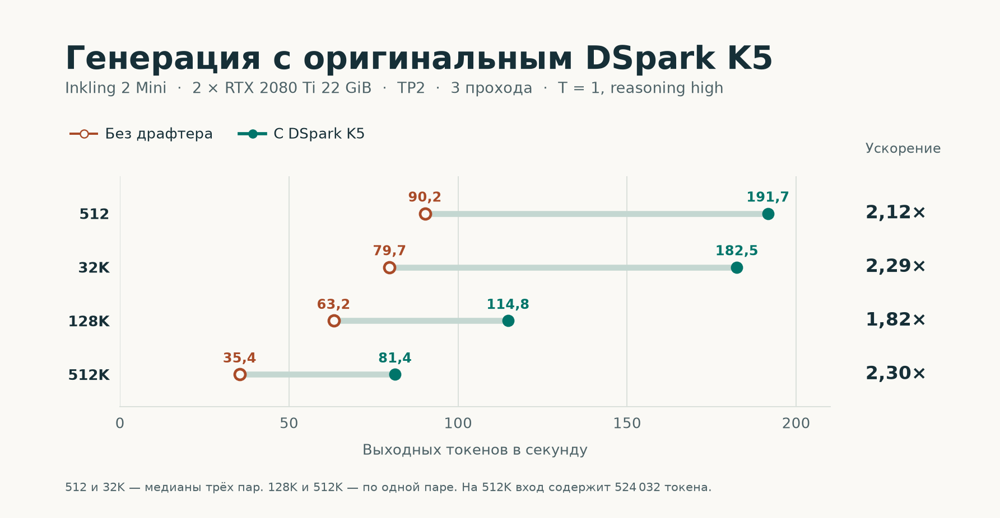
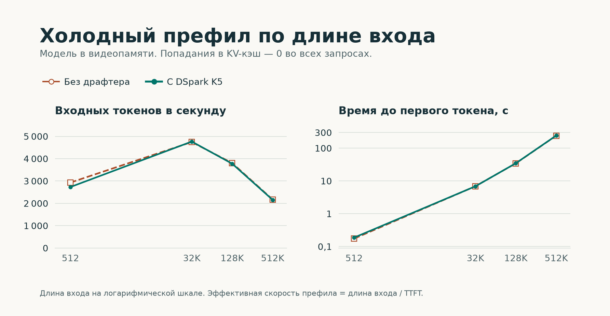
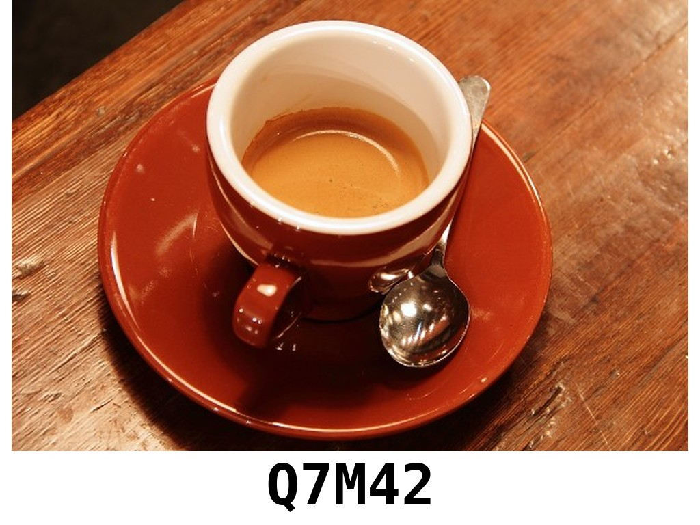
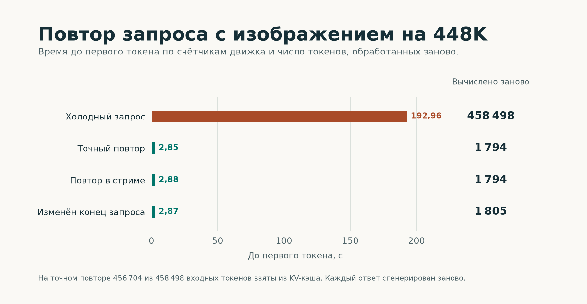

# Inkling 2 Mini на двух RTX 2080 Ti

Рецепт для двух **RTX 2080 Ti по 22 ГиБ с NVLink**: полный tensor parallelism (TP2), оригинальные веса **NVFP4 + MXFP8**, штатный драфтер **DSpark**. В текстовом профиле с контекстом 512K получили **81,36 ток/с** генерации, **35,39 ток/с** при отключённом драфтере и около **4 минут** до первого токена на новом документе из 524 032 токенов. [Парные измерения](docs/benchmarks.md)



| Профиль | Что помещается на двух GPU | Проверенный запрос |
|---|---|---|
| `text-512k` | Языковая модель, DSpark и KV в видеопамяти. Три прохода, один запрос. | 524 032 входных + 256 выходных токенов |
| `vision-448k` | На каждом GPU также размещается визуальный энкодер, около 607 МиБ на карту. | 458 496 входных с фотографией + 256 выходных, 80,89 ток/с генерации |

Цифры относятся к модифицированным 22-гигабайтным картам. Контекст в таблице включает и ввод, и зарезервированный вывод. Шкалы весов берутся из исходного чекпойнта. Turing исполняет умножения через поддерживаемые FP16-ядра с подготовкой весов.

На заново собранном движке повторили текстовый тест с 32 768 входными токенами и тремя seed. Медиана генерации получилась **182,40 ток/с** при исторических **182,46**. Все три счётчика принятых предложений DSpark совпали с исходными замерами. [Контрольный запуск и данные](docs/build.md#контрольный-запуск-из-опубликованных-исходников)

## Запуск

[English quick start and results](docs/english.md)

Склонируйте рецепт и перейдите в его каталог.

```bash
git clone https://github.com/qwerty12ss/inkling-2-mini-2080ti.git
cd inkling-2-mini-2080ti
```

1. Подготовьте программное окружение и соберите зафиксированную версию vLLM с CUDA-ядрами SM75. [Сборка](docs/build.md)
2. Скачайте оригинальный чекпойнт с драфтером, проверьте контрольные суммы и подготовьте локальный кэш весов. Запустите один из двух профилей. [Команды запуска](docs/run.md)
3. Проверьте живой сервер. По умолчанию тесты обращаются к `http://127.0.0.1:8000`. При включённой авторизации передайте ключ через переменную `INKLING_API_KEY`.

```bash
# Текстовый профиль: арифметика и реальное попадание в KV-кэш на повторе
python3 tests/smoke.py --cache

# Профиль vision-448k: дополнительно проверяет содержимое картинки и OCR
python3 tests/smoke.py --cache --vision

# Проверки без GPU: тесты, данные и параметры запуска
make check
```

Публичный тест выполнялся на действующем профиле GPU-vision. На повторе из 8 007 входных токенов 6 144 пришли из KV-кэша. В отдельном запросе модель вернула `COFFEE Q7M42`, а в `usage` указала 521 токен изображения. [Вывод проверки](tests/observed-smoke.json)

## Холодный префил

На 32K итоговый профиль обрабатывал около **4 766 входных ток/с**, на 128K — около **3 770**, на 512K — **2 159**. Это скорость от отправки запроса до первого полученного токена при резидентной модели и нулевых попаданиях в KV-кэш. Для повторного запроса с готовым префиксом измеряется отдельная задержка. [Данные, методика и воспроизведение графиков](docs/benchmarks.md)



## Проверка изображения на 448K

В конец архива кода поместили фотографию и попросили назвать предмет и переписать пятисимвольную подпись. При полном окне модель начала ответ строкой **COFFEE Q7M42**. До первого токена прошло **197,29 с**. Минимум свободной видеопамяти составил около **680 и 682 МиБ**. При повторном публичном запросе с 458 498 входными токенами движок переиспользовал **456 704**, ещё **1 794** обработал заново. [Результаты](docs/benchmarks.md) · [Источник фотографии](assets/fixtures/README.md)



На повторе запроса с фотографией время до первого токена сократилось со **192,96 до 2,85 с**. Изменение последней фразы сохранило попадание в длинный общий префикс. Измерить это на своей паре карт можно командой `python3 benchmarks/run_vision.py --tokens 458496` после старта профиля `vision-448k`.



## Эксперименты и ограничения

Разобраны вариант с пятью проходами, каскад с разреженным вниманием, сжатие KV и правка повторяемости для короткого промпта. Для каждого указаны измерения и причина выбора финального профиля. Отдельно приведены результаты по арифметике, извлечению фактов и длинным многоходовым диалогам. [Журнал экспериментов](docs/experiments.md) · [Индивидуальные результаты](docs/experiments-data.json)

Авторы модели — Thinking Machines Lab. Это независимый рецепт для Turing. [Модель и условия использования](https://huggingface.co/thinkingmachines/Inkling-2-Mini) · [Авторы кода, ядер и фотографии](THIRD_PARTY.md)
