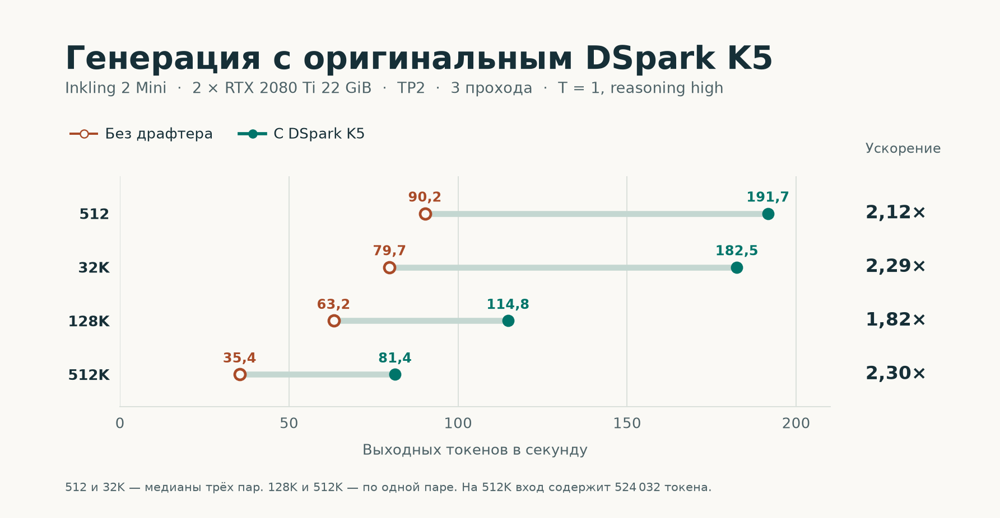
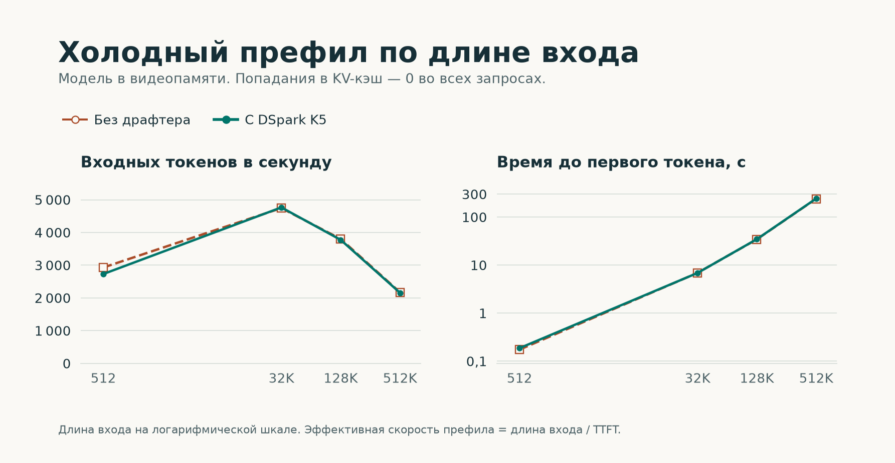
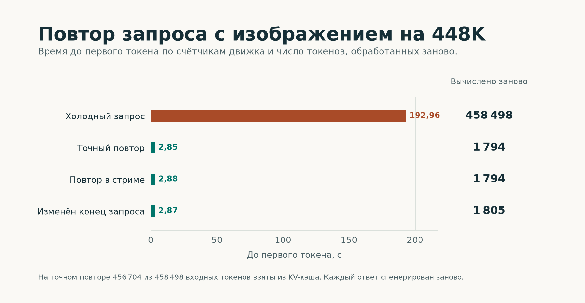

# Замеры на двух RTX 2080 Ti по 22 GiB

24 ноября 2026 года. Две карты соединены NVLink. Один запрос, Tensor Parallel 2, три прохода Inkling 2 Mini и исходные веса NVFP4 + MXFP8. Модель уже находится в памяти к началу каждого измерения. «Холодный» означает ноль токенов из префиксного кэша. Подгрузка модели в тайминги не входит.

## Текст, с драфтером и без него

Для каждой пары совпадают входные токены, seed, семплирование и конфигурация основной модели. Серийный режим обрабатывает один токен за шаг. В режиме K5 оригинальный DSpark предлагает до пяти токенов за раунд. Температура основной модели равна 1, `top_p=1`, шаблон `reasoning_effort=high`, бюджет ответа 256 токенов. Конечный токен может завершить ответ раньше.

| Вход, токены | Генерация без драфтера, ток/с | Генерация с K5, ток/с | Ускорение | Холодный префил без / с K5, ток/с | До первого токена без / с K5, с |
|---:|---:|---:|---:|---:|---:|
| 512 | 90,19 | 191,65 | 2,12× | 2 932 / 2 733 | 0,175 / 0,187 |
| 32 768 | 79,74 | 182,46 | 2,29× | 4 746 / 4 766 | 6,90 / 6,87 |
| 131 072 | 63,19 | 114,77 | 1,82× | 3 803 / 3 776 | 34,47 / 34,71 |
| 524 032 | 35,39 | 81,36 | 2,30× | 2 174 / 2 159 | 241,07 / 242,76 |



В строках 512 и 32K показаны медианы по трём seed (863, 1729, 1811). Ускорение рассчитано как отношение медианных скоростей. Для 128K и 512K есть по одной паре с seed 1729. В этих двух длинных запросах движок принял 159 из 500 предложенных токенов (31,8 %) и 166 из 415 (40,0 %) соответственно. Счётчики относятся ко всему ответу. На полном окне 524 032 входных плюс 256 выходных заполняют ёмкость 524 288. [Построчные замеры и счётчики DSpark](../benchmarks/data/text-pairs.csv)

**Как засекали генерацию.** Таймер запускается в момент получения первого SSE-фрагмента с идентификаторами токенов. Числитель — число выходных токенов после этого фрагмента. В паре обеим сторонам задаётся одинаковая конечная позиция. На коротком входе выбрали 128-ю позицию для всех трёх пар, поскольку один серийный ответ закончился до 256. В остальных строках конечная позиция 256. При получении нескольких токенов в одном фрагменте используется время прихода фрагмента, содержащего конечную позицию.

**Как засекали префил.** Эффективная скорость в таблице равна длине входа, поделённой на клиентское время от отправки запроса до первого выходного токена (TTFT). В это время входят также обработка запроса и начало генерации.



Отдельно записаны 24 холодных прогона K5 до естественного конца или лимита ответа. На 128K медиана **полного ответа** по трём seed составила 136,32 ток/с на контрольном тексте и 141,05 на втором корпусе из документации vLLM. На 512K — 81,36 и 75,18 ток/с. Файл содержит оба корпуса, длину каждого ответа, время и хэш входа. [Измерения до конца ответа](../benchmarks/data/text-k5-full.csv)

## GPU vision и повтор префикса

В профиле с окном 458 752 визуальный энкодер, основная модель, DSpark K5 и KV размещены на тех же двух GPU. Для этого профиля измеряли K5. Парные запуски с отключённым драфтером доступны для текстового профиля выше. Обработка фото 1024 × 768 занимает 521 входной токен.

| Вход | Изображение | Холодный префил движка, с | Входных ток/с | До первого токена в движке, с | Генерация, ток/с |
|---:|---:|---:|---:|---:|---:|
| 209 | 600 × 400 | 0,240 | 871 | 0,257 | 178,45 |
| 228 | 512 × 512 | 0,360 | 634 | 0,386 | 102,64 |
| 6 576 | 1024 × 768 | 1,575 | 4 174 | 1,635 | — |
| 458 496 | 1024 × 768 | 195,785 | 2 342 | 197,223 | **80,89** |
| 458 498 | 1024 × 768 | 191,304 | 2 397 | 192,962 | — |

Здесь длительность префила взята из `request_prefill_time_seconds_sum`, TTFT из `time_to_first_token_seconds_sum`. В прямом длинном запросе измерены 256 выходных токенов и 3,15245 с стадии декода. Скорость составляет 255 / 3,15245 = 80,89 ток/с. Интервал между клиентской отправкой и первым токеном для него составил 197,286 с. На двух коротких фото ответы содержали всего 42 и 43 токена, по одному прогону на фото. Для двух строк со знаком «—» архив содержит время префила и TTFT. Минимальный наблюдаемый остаток свободной видеопамяти во время прямого длинного запроса — около 680 и 682 MiB по картам (период выборки 20 мс). [Исходные счётчики и память](../benchmarks/data/vision-cold.csv)



При точном повторе запроса с 458 498 входными токенами движок взял 456 704 токена из префиксного кэша и вычислил оставшиеся 1 794. Время до первого токена снизилось с 192,96 с до 2,85 с. После изменения последней фразы кэш дал те же 456 704 токена, заново потребовалось вычислить 1 805. Счётчики отражают четыре отдельных генерации. Токены изображения входят во вход, токены рассуждения — в выход. [Все четыре запроса и счётчики](../benchmarks/data/vision-prefix.csv)

## Повторить измерение

Запустите текстовый профиль по [рецепту сервера](run.md). Во втором терминале выполните команду из корня репозитория. Она отправляет один запрос напрямую в vLLM, проверяет длину входа и подтверждает ноль попаданий в префиксный кэш. При включённой авторизации клиент читает ключ из `INKLING_API_KEY`. Также поддерживается `VLLM_API_KEY`.

```bash
mkdir -p results-local
python3 benchmarks/run_text.py --model inkling-2-mini-3loop \
  --tokens 32768 --seed 1729 --output results-local/k5-32k-seed1729.json
```

Для серийного контроля перезапустите `scripts/serve.sh text-512k --no-drafter` с теми же картами, выполните ту же команду и задайте новое имя файла результата. Для воспроизведения опубликованных пар используйте наборы (длина, seed) из CSV. Клиент отмечает `matched_decode_tok_s` как `null`, если ответ завершился до контрольной позиции. Полная скорость в таком случае остаётся доступной при наличии второго фрагмента потока.

`run_text.py` строит контрольный текст о трёх складских балансах через `/tokenize`. Проверены SHA-256 массивов токенов для всех четырёх длин. Хэш считается по UTF-8 JSON-массиву целых токенов с разделителями `,` и `:` без пробелов. Сравните `prompt_ids_sha256` своего запуска с записью CSV, чтобы проверить совпадение токенизатора и шаблона. Второй корпус документации представлен готовыми измерениями.

## Повторить тест с фотографией и кэшем

Запустите профиль `vision-448k`. Скрипт использует синтетический складской журнал и открытую фотографию из репозитория. Исторические замеры на 448K выше получены на другом тексте. Для сравнения на своей машине выполните во втором терминале короткий прогон, а затем длинный. Во время замера сервер должен обслуживать только эти запросы.

```bash
mkdir -p results-local
python3 benchmarks/run_vision.py --tokens 8192 --output results-local/vision-8k.json
python3 benchmarks/run_vision.py --tokens 458496 --output results-local/vision-448k.json
```

`/tokenize` проверяет точную длину отформатированного входа вместе с изображением. На 458 496 токенах остаётся место для 256 выходных токенов. Флаг `--tokenize-only` проверяет длину и резерв для ответа без генерации. В обычном режиме скрипт дважды отправляет один запрос с одинаковой солью. Для первого проверяет нулевое чтение KV, для второго — попадание в кэш. В обоих ответах проверяются число позиций изображения (521), итоговый счётчик токенов и распознанный текст `COFFEE Q7M42`. Если модель ошиблась при чтении фото, результат с её ответом сохраняется, а процесс возвращает ненулевой код.

25 ноября 2026 года на действующем профиле проверка на 8 192 входных токенах дала `COFFEE Q7M42` и 46 выходных токенов оба раза. При повторе движок прочитал 6 144 токена из KV, вычислил ещё 2 048 и вернул первый токен за 0,468 с. Холодный TTFT составил 1,730 с. На отдельно запущенной сборке по этому рецепту `/tokenize` подтвердил ровно 458 496 токенов для того же открытого теста в длинном режиме. Замер времени на таком синтетическом входе выполняет вторая команда выше.

Поля `engine_ttft_s`, `engine_prefill_s` и `engine_decode_s` взяты из `/metrics` выделенного движка и проверены по числу завершённых запросов. `engine_decode_tok_s` равен `(выходные токены − 1) / engine_decode_s`. `client_wall_s` включает весь HTTP-запрос и передачу ответа. Флаги `--base-url`, `--model` и переменные авторизации те же, что и в текстовом тесте. [Фотография и источник](../assets/fixtures/README.md) · [Код теста](../benchmarks/run_vision.py)

## Проверить числа и построить графики

Проверка CSV покрывает состав пар, совместимость входов, число выданных и принятых токенов, скорости по исходным длительностям и баланс `cached + computed = input`. Генератор графиков читает эти же CSV. Для проверки чисел достаточно стандартного Python. Графики в репозитории построены с Matplotlib 3.11.2.

```bash
python3 benchmarks/check_data.py
python3 -m venv .work/plot-venv
.work/plot-venv/bin/pip install 'matplotlib==3.11.2'
.work/plot-venv/bin/python benchmarks/plot.py
```
